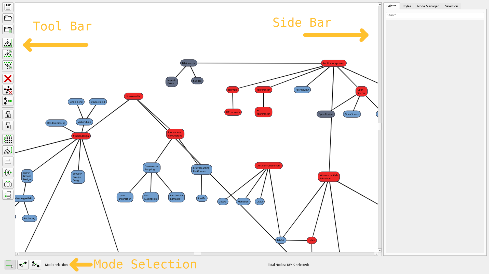
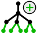
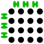
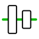
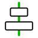
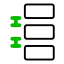
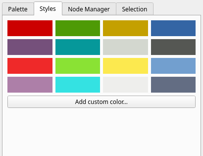
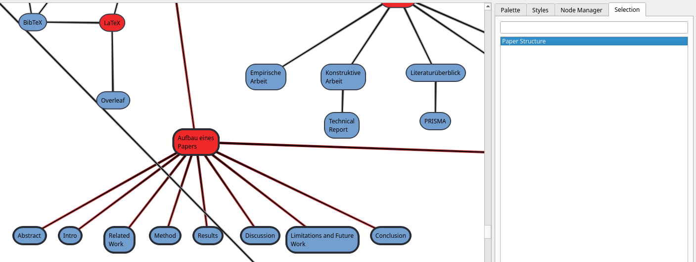

# GraphIT Course Editor

## Usage

The GraphIT Course Editor can be used to manually create and edit graphs in a simple UI.
Nodes can be created, moved, arranged, and renamed, as well as connected with each other.

| **Feature** | **Description** |
| --- | --- |
| Creating a Node | The most simple way to create a node is to double click the canvas. Then, a node name can be entered via a popup prompt and then, a node is created at the click position. Nodes can also be added to the graph by dragging them from the node palette (see below) or by dragging any text into the canvas. When the latter feature is used, a new node is created for each line in the pasted text. |
| Deleting Nodes | Nodes (and their connections) can be deleted with the *del* key or the *delete* button in the toolbar. |
| Moving Nodes | Nodes can be moved by dragging them around with the mouse. |
| Navigating the Canvas | The mouse wheel can be used to move the view up and down, holding *Shift* while using the mouse wheel moves left and right. Pressing and holding the middle mouse button allows for panning. Holding *Ctrl* while scrolling the mouse wheel zooms the viewport. This can also be achieved with *Ctrl* and the plus/minus keys. |
| Connecting Nodes | In order to connect nodes, one must first switch to the *Connection Mode* by either clicking the corresponding button in the status bar or using the *Ctrl + C* shortcut. While in connection mode, if one or more nodes are selected, clicking another node establishes a new connection from the selected nodes (source) to the clicked node (sink). While in selection mode, if nodes are selected, a dashed line from selected nodes to the mouse cursor indicates where a connection would be created. |
| Deleting Connections | Connections can be deleted individually while in *Cut Mode* (entered with the corresponding button in the status bar, or the *Ctrl + X* shortcut). While in cut mode, connections can be cut by striking them out with the mouse. In order to delete all connection of a node, the corresponding button in the toolbar can be used. |

## GUI



### Toolbar

| Icon | Function | Shortcut | Description |
| ---- | -------- | -------- | ----------- |
|  | Save Graph | Ctrl + S | Saves the graph to the "projects" directory. If the project name is not yet set, a project name can be entered via a popup prompt. |
|  | Ctrl + O | Open Graph |  |
|  |  | Load Node List |  |
|  | Ctrl + A | Select All |  |
|  |  | Select Children |  |
|  |  | Select Parents |  |
|  | del | Delete Nodes |  |
|  |  | Delete Connections |  |
|  |  | Merge Nodes |  |
|  |  | Lock Selection |  |
|  |  | Unlock Selection |  |
|  |  | Arrange in Square |  |
|  |  | Arrange by Parent Count |  |
|  |  | Align Vertical |  |
|  |  | Align Horizontal |  |
|  |  | Distribute Horizontal |  |
|  |  | Distribute Vertical |  |

### Side Bar

| **Node Palette** |  |
| --- | --- |
|  | List of nodes that can be dragged into the canvas. The node list can be loaded with the "Load Node List" button. A node list is a plain text file with one node name per line. |
| **Style Palette** |  |
|  | Color palette that can be used to assign colors to nodes. There is a small standard palette, but custom colors can be added with the corresponding button. |
| **Node Manager** |  |
|  | Tabular overview of all nodes in the graph. Displays the number of children and parents for each node. Double clicking a list entry focuses the viewport on the corresponding node. Can be useful to identify unconnected nodes (nodes without children and parents). |
| **Selection Manager** |  |
|  | Clicking the "Store Selection" button allows for saving and later restorig the current node selection. Selections are named via a text input prompt. Double clicking a list item restores the corresponding selection. Useful to quickly select sub-graphs. |


## Project File Structure

```
projects/
|
|-- project1/
|   |
|   |-- project1_nodes.csv
|   |-- project1_connections.csv
|   |-- topics.txt (optional)
|
|-- project2/
|
...
```

By default, projects are stored in a project directory within the "projects" subdirectory.
The project directory is named after the project, as are files within.
A project consists mainly of two CSV files: nodes and connections.
They are, again, named according to the project name as specified when first saving the project.

The *nodes* file has one line per node.
It has columns for the node ID, node label, node position, and color in hex format.

The *connections* file has one line per edge (connection between two nodes).
Connections have their own ID and store two node IDs:
the *source* node (parent), and the *sink* node (child, receiving the connection).
