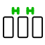
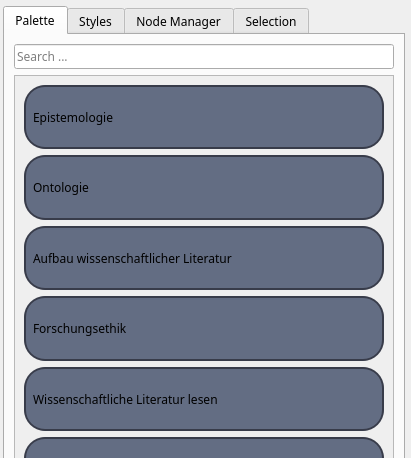
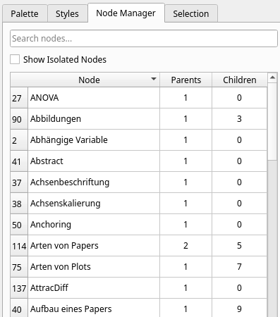

# GraphIT Course Creator

## GUI

### Toolbar

| Icon | Function | Shortcut | Description |
| ---- | -------- | -------- | ----------- |
|  | Save Graph | Ctrl + S | Saves the graph to the "projects" directory. If the project name is not yet set, a project name can be entered via a popup prompt. |
|  | Ctrl + O | Open Graph |  |
|  |  | Load Node List |  |
|  | Ctrl + A | Select All |  |
|  |  | Select Children |  |
|  |  | Select Parents |  |
|  | del | Delete Nodes |  |
|  |  | Delete Connections |  |
|  |  | Merge Nodes |  |
|  |  | Lock Selection |  |
|  |  | Unlock Selection |  |
|  |  | Arrange in Square |  |
|  |  | Arrange by Parent Count |  |
|  |  | Align Vertical |  |
|  |  | Align Horizontal |  |
|  |  | Distribute Horizontal |  |
|  |  | Distribute Vertical |  |

### Side Bar

**Node Palette**

|  | List of nodes that can be dragged into the canvas. The node list can be loaded with the "Load Node List" button. A node list is a plain text file with one node name per line. |

**Style Palette**

|  | Color palette that can be used to assign colors to nodes. There is a small standard palette, but custom colors can be added with the corresponding button. |

**Node Manager**

|  | Tabular overview of all nodes in the graph. Displays the number of children and parents for each node. Double clicking a list entry focuses the viewport on the corresponding node. Can be useful to identify unconnected nodes (nodes without children and parents). |

**Selection Manager**

|  | Clicking the "Store Selection" button allows for saving and later restorig the current node selection. Selections are named via a text input prompt. Double clicking a list item restores the corresponding selection. Useful to quickly select sub-graphs. |
